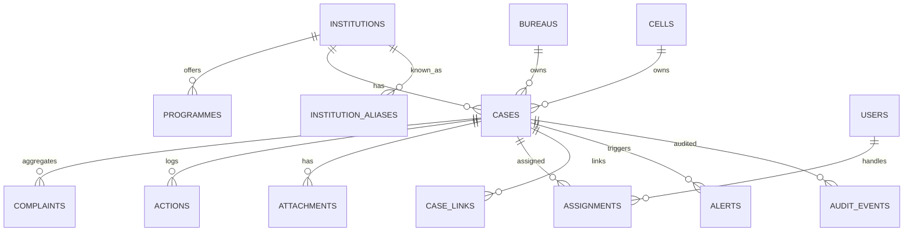

# AICTE Samanvay
## Research & Build Blueprint for SIH 2026 Problem Statement SIH26264
### “Integrated Dashboard for Monitoring and Tracking Institution-Related Complaint Cases Across AICTE Bureaus/Cells”

**Prepared:** 26 October 2026  
**Purpose:** Domain research, product strategy, hackathon plan, and a realistic build assessment.

---

## 0. Executive summary

### The problem in one line
AICTE already receives complaints through multiple channels and handles them in multiple bureaus/cells, but there is no institution-centric, real-time view that tells an officer: *what else is open against this institution, who owns it, what stage it is at, and whether our actions are about to collide.*

### The winning thesis
**Do not build another complaint intake portal. Build the coordination layer over the portals AICTE already has.**

Position it as:
> **AICTE Samanvay — One Institution. One Case File.**  
> A federated institution-complaint command centre that unifies case identity, ownership, timelines and cross-bureau action.

This framing matters for three reasons:
1. It respects existing systems (CSS, CPGRAMS, emails, regional offices, bureau registers) instead of pretending they do not exist.
2. It focuses the demo on the exact pain in the problem statement: overlapping RB/PGRC action and duplication.
3. It is technically achievable in a 36-hour hackathon and credible as a production pilot.

### What to build in the hackathon
A working, seeded web application with:
- **Institution 360** keyed on AICTE Permanent ID, with aliases and a consolidated complaint history.
- **Unified case registry** with a unique case ID, bureau/cell ownership, status, officer, last action, next action, SLA and full timeline.
- **Overlap detection engine** that flags “Potential Overlapping Cases – Coordination Required” across bureaus using institution matching + semantic similarity + rules, with an explainable “why flagged” panel.
- **Command Centre dashboard** with KPIs, bureau workload, region map, ageing, overdue cases and trends.
- **Coordination workspace** to link/merge cases, record joint decisions and prevent conflicting notices.
- **Alerts, reports, search, RBAC and an immutable audit trail.**
- **AI-assisted triage** (category, severity, suggested owner, missing information) with a human confirm step.
- **Synthetic complaint data + real public AICTE institution master data** to make the demo realistic without using real complainants’ data.

### Can it be built?
**Yes — the full software prototype can be built here.** I can deliver the database, backend, frontend, AI service, seed data, Docker setup, demo script and pitch deck content. What cannot be built without AICTE is the *official* integration: live CSS/CPGRAMS APIs, real complaint data, production hosting on NIC/MeitY cloud, legal sign-off and real SMS/email gateways. Those are organisational access problems, not coding problems.

### Urgent deadline
The official PS listing showed **deadline 28 October 2026** and **52/500 ideas submitted** at the time of research. If the idea PPT has not been submitted, that is the immediate priority — before any code. Verify the live portal; SIH deadlines have been extended/changed before.

---

## 1. Hackathon context

### 1.1 SIH 2026 at a glance
- **Edition:** 9th edition of Smart India Hackathon.
- **Run by:** Ministry of Education’s Innovation Cell (MIC) and AICTE.
- **Scale (2026 snapshot):** 260 problem statements, 37 organisations, 17 themes; 196 software and 69 hardware statements on the official page.
- **AICTE’s portfolio:** 34 problem statements (17 software, 17 hardware), including five Regulation Bureau software statements around approvals, document validation, APAAR, security deposits and this complaint dashboard.
- **Idea stage:** teams submit a **maximum 6-slide PDF** idea presentation; shortlisted teams go to the Grand Finale.
- **Evaluation themes:** novelty, complexity, clarity, feasibility, practicability, sustainability, scale of impact, user experience, future work.

### 1.2 This problem statement

| Field | Detail |
|---|---|
| PS ID | **SIH26264** |
| Organisation | **AICTE** |
| Department | **Regulation Bureau** |
| Category | **Software** |
| Theme | **Smart Automation** |
| Title | Integrated Dashboard for Monitoring and Tracking Institution-Related Complaint Cases Across AICTE Bureaus/Cells |
| Deadline shown | **28 October 2026** |
| Ideas shown | **52 / 500** (research snapshot) |

### 1.3 What the PS actually asks for
The official brief asks for a single-window dashboard for authorised AICTE officials to:
- View all institution-related complaint/grievance cases in one place.
- Identify the bureau/cell currently handling each case.
- Track complete status and movement.
- Identify overlapping RB/PGRC actions or multiple bureaus/cells dealing with the same institution.
- Avoid duplication and ensure coordination.
- Monitor pending, disposed, under-process, transferred and escalated cases.
- Generate institution-wise, region-wise, bureau/cell-wise and status-wise reports.
- Alert on pending cases and cases approaching prescribed timelines.

It then lists eight expected feature groups:
1. Centralised institution profile (Permanent ID, name, address, region, history).
2. Complaint/case tracking (ID, receipt date, category, status, bureau/cell, officer, last action, next action, expected disposal).
3. Cross-bureau/cell overlap detection (automatic, with linking/mapping).
4. Real-time dashboard (totals, pending, in-process, disposed, transferred, overdue, institution-wise, bureau workload).
5. Workflow and action history (chronological, actor, timestamp, remarks, documents, transfer/escalation).
6. Search and filters.
7. Alerts and notifications (duplicate/overlap, pending, escalation, SLA).
8. Reports and analytics (bureau, region, institution, ageing, disposal rate, overlaps, monthly/quarterly).

And one innovation ask:
> Use data matching, rule-based logic and/or AI-assisted analytics to identify complaints relating to the same institution even when descriptions or case references differ.

The example in the PS is precise: Institution A has a PGRC case “under process” and an RB case “action initiated”; the system should display **“Potential Overlapping Cases – Coordination Required.”**

### 1.4 Theme analysis
The assigned theme is **Smart Automation**. This is not primarily a “Smart Education” app; it is a governance-automation product. The strongest theme story is:

- **Primary: Smart Automation** — automate institution resolution, triage, routing, SLA clocks, duplicate detection, escalation and reporting.
- **Secondary: Smart Education** — the domain is technical-education regulation; the outcome is better institutional accountability and student protection.
- **Trust layer: Blockchain & Cybersecurity** — only if it earns its place. A hash-chained audit log gives tamper-evidence without blockchain theatre. Do not put “blockchain” on the slide unless you can explain the exact threat it removes.

### 1.5 What judges will reward
From the SIH evaluation criteria and typical Grand Finale rubrics:
- A **working prototype**, not a mockup.
- **Clarity of problem understanding** — show that you know AICTE’s actual bureaus, channels and constraints.
- **Novelty** — the overlap/coordination engine is the novelty; a generic dashboard is not.
- **Technical depth** — entity resolution, semantic similarity, workflow state machine, audit trail, RBAC.
- **Feasibility** — realistic integration story, not “we will connect to everything.”
- **Impact** — measurable reduction in duplication and disposal time.
- **UX** — an officer can understand the screen in 10 seconds.
- **Sustainability** — configurable rules, open standards, no vendor lock-in.

---

## 2. Domain research

### 2.1 What AICTE is
The All India Council for Technical Education is the statutory regulator for technical education in India (AICTE Act, 1987). It approves technical institutions and programmes, sets norms and standards through the Approval Process Handbook (APH), and handles grievances and complaints against approved institutions.

Its regulatory scope covers engineering and technology, architecture and town planning, management, pharmacy, computer applications, design, hotel management and catering, and related programmes.

### 2.2 Organisational map relevant to complaints

**Bureaus (indicative, from AICTE’s public organisation pages):**
- **Regulation / Approvals Bureau (RB)** — approval processing, APH compliance, violations of norms and standards.
- **Administration Bureau** — establishment, nominations, logistics, rules and regulations.
- **Finance Bureau** — plan/non-plan accounts, payments, financial administration.
- **Policy & Academic Planning Bureau** — policy, curricula, academic planning, coordination with states.
- **Training and Learning Bureau** — faculty development, ATAL, training.
- **Scholarships and Grants** — scholarship schemes and grants.

**Cells and units (indicative):**
- **Public Grievance Redressal Cell (PGRC)** — general grievances from students, faculty, staff and stakeholders; handles APH-violation complaints through the **Standing Complaint Scrutiny Committee (SCSC)**.
- **Anti-Ragging Cell** — ragging complaints and prevention.
- **SC/ST Cell, OBC Cell, Women’s Cell / Internal Complaints Committee (ICC), Legal Cell, Vigilance Cell, RTI Cell, Estate Management, Universal Human Values Cell, NEAT, Innovation Cell, Cyber Security Cell.**
- **Regional offices/committees** — Northern, North-West, Western, Southern, South-West, South-Central, Eastern and Central; regional offices in Kanpur, Chandigarh, Mumbai, Bhopal, Vadodara, Kolkata, Guwahati, Bengaluru, Hyderabad, Chennai, Thiruvananthapuram and Delhi HQ.

This matters for the product: the dashboard cannot assume one queue. It needs a **bureau/cell/region hierarchy**, delegated ownership, and data scopes.

### 2.3 How a complaint flows today (as publicly described)

A realistic current-state journey:

1. **Intake** through one of many channels:
   - AICTE Centralized Support System (CSS).
   - CPGRAMS.
   - Ministry of Education / other government references.
   - Email to `complaint@aicte-india.org` or other cell inboxes.
   - Physical letters and representations.
   - Regional office walk-ins/calls.
   - Anti-ragging helpline/portal, ICC, and institution-level SGRC/GRC.
2. **Manual triage** by the receiving cell/officer.
3. **Routing** to PGRC, RB, a cell, or a regional office.
4. **Institution identification** from name/address/Permanent ID, often manually.
5. **Case processing** through notices, replies, scrutiny, hearings, inspections, SCSC, etc.
6. **Disposal/closure**, sometimes with parallel action by another bureau.
7. **Reporting** through registers, emails, spreadsheets and management summaries.

The PS exists because steps 2–7 are not federated around the institution.

### 2.4 Regulatory clocks you can encode

| Process | Publicly stated timeline | Product implication |
|---|---|---|
| CSS query/complaint response | **72 working hours** (as announced at launch) | First-response SLA for CSS-origin cases |
| Institution SGRC (student grievance) | Complaint referred to SGRC; report within **15 days** of receipt | Institution-level clock; escalation if no response |
| Appeal to Ombudsperson | Within **15 days** of SGRC decision | Appeal window tracker |
| Ombudsperson resolution | **30 days** of receiving appeal | Ombudsperson SLA |
| Faculty/staff GRC | Report within **15 days** | GRC SLA |
| CPGRAMS | Departmental timelines + appeal/feedback loop | Ingested cases inherit CPGRAMS reference and clock |
| AICTE APH approval/compliance | Timelines vary by stage/undertaking | Configurable, not hardcoded |

**Design rule:** make SLAs **configurable by category, severity, source and bureau**, and show the legal/regulatory basis for each clock. Do not hardcode one universal deadline.

### 2.5 Existing systems landscape — and why they are not enough

| System | What it does | Gap this product fills |
|---|---|---|
| **AICTE CSS** | Centralised support system launched 15 Dec 2021; suggestions, enquiries, grievances, complaints, appreciation, support requests; auto-routes to concerned bureau/cell/regional office; 72-hour response. | CSS is intake/ticketing. It does not give an institution-centric, cross-bureau case graph or overlap detection. |
| **CPGRAMS** | Government-wide grievance platform; 24x7, 22 languages, Bhashini integration, AI/ML analytics, auto-routing, appeals, mobile/UMANG/CSC. | AICTE receives CPGRAMS cases but needs to reconcile them with CSS/email/RB cases for the same institution. |
| **UGC e-Samadhan** | Single-window grievance registration and monitoring with docket numbers and timelines. | A useful benchmark for consolidation; does not solve AICTE’s internal bureau coordination. |
| **Anti-ragging portal/helpline** | Dedicated ragging complaints. | Sensitive cases need sealed handling and linkage without exposing identities. |
| **Institution SGRC/GRC/ICC portals** | Institute-level grievance redressal as per AICTE regulations. | AICTE needs visibility into escalation and repeat institutions, not just the institute’s own register. |
| **State DTE / university portals** | State-level grievance and affiliation processes. | Cases may escalate from these; the dashboard should ingest references, not replace them. |
| **Bureau registers/emails/Excel** | The real current “system” in many offices. | This is the data that must be normalised and migrated. |

**Strategic conclusion:** the product should be a **federation and coordination layer**, with adapters for CSS, CPGRAMS, email, CSV and manual entry. The demo can simulate these adapters; the pitch should be honest that live integration requires AICTE authorization.

### 2.6 Institution identity is the hard part

AICTE uses a **Permanent Institute ID** (format like `1-7385960821`) alongside application numbers, names, addresses and approval status. Public AICTE lists expose Permanent ID, name, state, district, city, region, institution type and approval status. There are roughly **12,000–13,000 approved institutions** in the public analytics dashboard, with programme/intake data.

Real-world identity problems:
- Name variants: “VIT” vs “Vellore Institute of Technology”; “M.S. Ramaiah” vs “MSRIT”; punctuation, ampersands, abbreviations.
- Campuses and parent trusts: same trust, multiple institutions; same institution, multiple campuses.
- Renamed institutions and merged entities.
- Missing/incorrect Permanent ID in complaints.
- Complaints that name a department, programme or person rather than the institution.
- Duplicate complaints from the same person across channels.
- Deliberate misspelling to avoid detection.

**Therefore:** institution resolution is not a side feature. It is the foundation of overlap detection. Build an alias table, normalisation pipeline, exact-ID short-circuit, fuzzy match and human confirmation.

### 2.7 Pain points — a structured diagnosis

1. **Case identity fragmentation** — same institution/complaint represented differently across systems.
2. **Ownership ambiguity** — “who is handling this?” is often answered by asking a person, not by reading a system.
3. **Parallel action risk** — RB and PGRC may issue notices or take positions without knowing about each other.
4. **Duplication of effort** — multiple officers verify the same institution, read the same documents, contact the same people.
5. **SLA blindness** — ageing and overdue cases are not visible in one place; escalation is manual.
6. **Reporting tax** — monthly/quarterly reports are assembled manually from registers and emails.
7. **Sensitive-case leakage** — ragging/POSH/SC-ST complaints need strict need-to-know, but shared drives and email make that hard.
8. **Legacy data** — years of PDFs, letters and spreadsheets with no structured fields.
9. **Complainant opacity** — a person may not know which bureau has their case or what stage it is at.
10. **Management blindness** — no real-time portfolio view of institutional risk, regional concentration or repeat offenders.
11. **Conflicting outcomes** — two units may close cases with inconsistent decisions.
12. **No institutional memory** — closed cases are not reused to inform new ones or approvals.

### 2.8 Complaint taxonomy (starter)

| Top category | Examples | Default owner | Sensitivity |
|---|---|---|---|
| Academic & examination | Results, evaluation, degree/certificate delay, curriculum | PGRC / academic cell | Normal |
| Admission & fees | Fee refund, capitation, admission denial, misleading claims | PGRC / RB | Normal–High |
| Approval & compliance | Unapproved course, excess intake, faculty shortage, infrastructure deficiency, APH violation | RB | High |
| Faculty & staff welfare | Salary, termination, service conditions, workload | PGRC / GRC | High |
| Student welfare | Hostel, transport, scholarship, safety | PGRC / regional office | Normal–High |
| Harassment & discrimination | Ragging, sexual harassment, caste/religion/gender/disability discrimination | Anti-Ragging / ICC / SC-ST / Women’s Cell | **Sealed** |
| Governance & finance | Misuse of funds, fake documents, financial irregularities | Vigilance / Finance / Legal | **Sealed/High** |
| Infrastructure & safety | Fire safety, building stability, lab safety | RB / regional office | High |
| Fake/unapproved institution | Unapproved institution, fake approvals, misleading advertising | RB / Vigilance | High |
| Other | Anything not classified | PGRC | Normal |

Each category should carry:
- Subcategories.
- Default bureau/cell and escalation matrix.
- SLA and severity rules.
- Required evidence checklist.
- Confidentiality level.
- Whether the institution can see the complaint.
- Whether the complainant identity must be masked.

### 2.9 Sensitive case classes — design for them explicitly
Ragging, sexual harassment, caste-based discrimination, SC/ST atrocities, medical/mental-health information, and whistleblower/vigilance complaints must not be visible to general dashboard users.

Product requirements:
- **Sealed case** flag with a separate access group.
- **Need-to-know** role assignment; no broad “admin sees all” in production.
- **Field-level encryption** for complainant identity and narrative.
- **Masked public status** (e.g., “Under process” without details).
- **Audit every view**, not just every edit.
- **Retention and deletion** rules aligned with law and AICTE policy.
- **No AI training** on sealed data without authorization.

### 2.10 Design principles

1. **Federate, do not replace.** Coexist with CSS, CPGRAMS, eOffice and bureau registers.
2. **Institution-first.** The institution is the primary key of the product experience.
3. **One case file, many complaints.** Separate raw intake from the actionable case.
4. **Human-in-the-loop AI.** AI suggests; officers decide.
5. **Explain every flag.** Show the institution match, text similarity, category match and rule triggered.
6. **Precision over recall for adverse flags.** A false “overlap” is annoying; a false “this institution is a repeat offender” is harmful.
7. **Configurable, not hardcoded.** Bureaus, SLAs, categories, routing and escalation must be admin-editable.
8. **Privacy by design.** Minimum data, need-to-know, sealed cases, audit.
9. **Legacy-friendly.** CSV/Excel/email/PDF ingestion with human verification.
10. **Demo-safe.** Every AI feature has a deterministic fallback.

---

## 3. Solution concept

### 3.1 Name and positioning
**AICTE Samanvay** (समन्वय = coordination)  
Tagline: **“One Institution. One Case File.”**  
Category: **Institution Complaint Coordination & Command Centre**.

Alternate names if needed: AICTE Setu, AICTE Netra, AICTE Ekatra, AICTE CaseGrid. “Samanvay” is the strongest because the PS is about coordination, not just monitoring.

### 3.2 The core insight
The dashboard should answer five questions in under 10 seconds:
1. **What is this institution’s full complaint footprint?**
2. **Which bureau/cell owns each case, and who is the officer?**
3. **What is the latest action, and what is supposed to happen next?**
4. **Are any cases overlapping or contradictory?**
5. **What is overdue, and who needs to act?**

If the UI answers those five, it wins the demo.

### 3.3 Personas and jobs-to-be-done

| Persona | Job to be done | Key screen |
|---|---|---|
| PGRC officer | Triage incoming complaints, route, track, dispose | Triage queue + Case workbench |
| RB officer | Investigate APH violations, coordinate with PGRC | Institution 360 + linked cases |
| Cell officer (Anti-Ragging/ICC/SC-ST) | Handle sealed cases with confidentiality | Sealed case workbench |
| Regional office | Verify institution, local follow-up | Region map + institution profile |
| Senior management | See portfolio risk, overdue cases, bureau performance | Command Centre |
| Institution representative | Respond to notices, upload documents | Institution portal (limited) |
| Complainant | Track status without exposing identity | Public tracker |
| Auditor/RTI | Verify actions and timelines | Audit log + reports |
| Admin | Configure taxonomy, SLAs, routing, users | Admin console |

### 3.4 End-to-end workflow

```
Intake (CSS / CPGRAMS / email / letter / web / CSV)
        ↓
Normalise + resolve institution (Permanent ID, alias, fuzzy, human confirm)
        ↓
AI triage (category, severity, sensitivity, suggested owner, missing info)
        ↓
Register case (unique case ID; link raw complaints)
        ↓
Assign / auto-route to bureau/cell/region + officer
        ↓
Acknowledge + start SLA clock
        ↓
Investigate (notice, reply, documents, hearing, inspection, SCSC)
        ↓
Overlap check (same institution, other bureaus, similar issue)
        ↓
Coordinate (link cases, joint note, single point of contact)
        ↓
Decision (action / closure / transfer / escalation / merge)
        ↓
Communicate + appeal window + closure
        ↓
Audit, analytics, institutional memory
```

### 3.5 Feature map to the official PS

| PS requirement | Product capability | Demo priority |
|---|---|---|
| Centralised institution profile | Institution 360 with Permanent ID, aliases, region, type, approval status, programmes, case history, risk score | **Must** |
| Complaint/case tracking | Case registry + workbench with ID, dates, category, status, owner, officer, last/next action, SLA | **Must** |
| Cross-bureau overlap detection | Overlap engine + queue + explainability + link/merge + coordination workspace | **Must (hero)** |
| Real-time dashboard | Command Centre with KPIs, bureau workload, region map, ageing, overdue | **Must** |
| Workflow/action history | State machine + immutable timeline + documents + transfer/escalation | **Must** |
| Search/filters | Global search + faceted filters + saved views | **Must** |
| Alerts/notifications | In-app alert centre + email/SMS adapter stubs + digest | **Should** |
| Reports/analytics | Bureau/region/institution reports, ageing, disposal rate, overlap metrics, PDF/Excel export | **Should** |
| AI-assisted matching | Entity resolution + multilingual embeddings + rules + explanations | **Must for innovation** |
| Institution response portal | Limited institution login to reply/upload | **Could** |
| Public complaint tracker | Case ID + OTP, status only | **Could** |
| Legacy ingestion | CSV/Excel import + email-in simulator + PDF text extraction | **Should** |

### 3.6 Differentiators (what makes it more than a dashboard)

1. **Case clustering, not just case listing.** A “case family” per institution/issue, with a parent-child graph.
2. **Coordination room.** Linked cases get a shared workspace: joint notes, single owner, agreed next action, conflict warning.
3. **Explainable overlap score.** “Same Permanent ID + 0.91 text similarity + both open + different bureaus + 12 days apart.”
4. **SLA blueprint with legal basis.** Each clock shows why it exists (CSS 72h, SGRC 15 days, Ombudsperson 30 days).
5. **Institution risk score.** Repeat complaints, severity, overdue rate, inspection outcomes, approval status — explainable, not a black box.
6. **Complaint-to-approval linkage.** Hook to the sibling AICTE approval PSs (SIH26262/26261) so a complaint can inform EoA scrutiny.
7. **Legacy ingestion workbench.** Human-assisted extraction from PDFs/emails, with confidence and review.
8. **Privacy-first sealed cases.** A demonstrable differentiator in a government context.
9. **Audit hash chain.** Tamper-evident action log without blockchain overhead.
10. **“No wrong door” experience.** A complainant can track a case regardless of which channel they used.

### 3.7 What not to build (scope discipline)
- A full public complaint intake portal competing with CSS.
- A complete approval workflow engine (that is SIH26262).
- A full document authentication/OCR platform (that is SIH26261).
- A blockchain network.
- A mobile app (responsive PWA is enough).
- A generic chatbot.
- Complex predictive ML with no training data.

---

## 4. The hero feature: cross-bureau overlap detection

### 4.1 Why it is hard
- The same institution has many names and IDs.
- The same issue can be described in different languages and vocabularies.
- Complaints may be about a department/programme, not the institution.
- Different bureaus use different case numbering and statuses.
- A duplicate is not always a duplicate: two complaints about the same fee refund may be separate students, and both deserve action.
- A link is not always a merge: one case may be a parent investigation and the other a related complaint.

### 4.2 Two-layer approach

**Layer 1 — Institution identity resolution**
- Exact match on AICTE Permanent ID.
- Normalised name match (case, punctuation, abbreviations, transliteration).
- Alias table (manual + learned).
- Fuzzy match: trigram/Jaro-Winkler + token set ratio.
- Supporting signals: state/district, address, website domain, phone, email, affiliation, AISHE code.
- Human confirmation for medium-confidence matches.
- Institution merge/split with full audit.

**Layer 2 — Case similarity and overlap**
- Category/subcategory match.
- Multilingual text embedding cosine similarity.
- Entity overlap: programme, department, person, amount, dates, locations.
- Temporal proximity.
- Source independence (different channels/complainants increases the value of a link).
- Rule triggers: same institution + both open + different bureau → at least “review”.
- Outcome: suggested link, duplicate, parent-child, or “related but independent”.

### 4.3 Scoring model (configurable)

A practical starting point:

```
overlap_score =
    0.30 * institution_identity_score
  + 0.25 * semantic_similarity
  + 0.15 * category_match
  + 0.10 * entity_overlap
  + 0.10 * temporal_proximity
  + 0.10 * cross_bureau_signal
```

Hard rules:
- Same Permanent ID + same category + both open + different bureau → **must review**, regardless of score.
- Same Permanent ID + identical source reference → **duplicate candidate**.
- Different Permanent IDs but same trust/address → **related institution** flag, not a duplicate.

Thresholds:
- `>= 0.85` → suggested link/duplicate.
- `0.65–0.85` → review queue.
- `< 0.65` → no action.

All thresholds and weights must be admin-configurable. Precision is more important than recall for adverse flags.

### 4.4 Human-in-the-loop
The system never auto-merges or auto-punishes. It creates a **suggested link** with reasons. An authorised officer can:
- Confirm link.
- Confirm duplicate/merge.
- Mark as related but independent.
- Reject with reason.
- Create a parent-child relationship.
- Open a coordination task.

Every decision is audited.

### 4.5 UX
**Overlap Queue** shows cards:
- Institution name + Permanent ID.
- Case A: bureau, category, status, officer, age.
- Case B: bureau, category, status, officer, age.
- Score + reasons.
- “Why flagged” expandable panel with text snippets and matching entities.
- Actions: Link, Merge, Dismiss, Assign coordinator.

**Institution 360** shows a **case graph**:
- Nodes = cases, colored by bureau.
- Edges = confirmed/suggested links.
- Cluster = “case family”.
- A banner: “3 open cases across RB, PGRC and Anti-Ragging Cell. Coordination required.”

### 4.6 Evaluation
Build a small labelled set of synthetic pairs:
- True duplicates (same institution, same issue, different wording).
- True overlaps (same institution, related issue, different bureaus).
- False friends (same generic issue, different institutions; same trust, different institutions; same student, two separate issues).
Measure:
- Precision, recall, F1 at the chosen threshold.
- False-positive rate.
- Officer review time.
- Reduction in duplicate actions in a tabletop exercise.
For the pitch, say “pilot target: >85% precision on the seeded evaluation set” — not “99% accuracy.”

### 4.7 Demo scenario (crafted)
Institution: **Siddaganga Institute of Technology** (real public institution, synthetic complaints).
- **Case 1 — PGRC:** “Fee refund not processed after admission withdrawal.” Status: under process. Received 40 days ago.
- **Case 2 — RB:** “Institution offering unapproved intake in a new programme.” Status: action initiated. Received 12 days ago.
- **Case 3 — Anti-Ragging Cell:** sealed complaint. Status: under inquiry.
- Intake a fourth complaint from email with a misspelled institution name and Hindi text: “फीस रिफंड नहीं मिला…”
- AI resolves the institution, translates, classifies as fee refund, and flags Case 1 as a duplicate candidate.
- The case graph shows RB + PGRC + Anti-Ragging open cases.
- Banner: “Potential Overlapping Cases – Coordination Required.”
- Officer links Case 1 and Case 4, opens a coordination room, assigns PGRC as lead, records a joint next action.
- Command Centre updates the overlap count, bureau workload and SLA risk.

This is a 3-minute story that maps exactly to the PS.

---

## 5. AI design (useful, not decorative)

### 5.1 Triage
Input: complaint text (any language), channel, complainant type, institution hint, attachments.
Output (JSON):
- Category/subcategory.
- Severity (low/medium/high/critical).
- Confidentiality (normal/high/sealed).
- Suggested bureau/cell + region.
- Suggested SLA.
- Missing information checklist.
- Confidence + rationale.
- Entities: institution, programme, department, dates, amounts, people.

Implementation:
- Rule/keyword baseline for reliability.
- LLM or a fine-tuned classifier for nuance.
- Human confirmation before routing.
- Store model version and rationale for audit.

### 5.2 Duplicate/overlap detection
- Multilingual embeddings (`BAAI/bge-m3`, `paraphrase-multilingual-MiniLM-L12-v2`, or IndicBERT-based).
- Cosine similarity in pgvector.
- Fuzzy institution matching.
- Rules for hard cases.
- Human confirmation.
- Feedback loop: officer decisions become labels for future tuning.

### 5.3 Summaries and similar cases
- “Case brief” for senior officers: 5 bullets, latest action, risk, next step.
- “Similar closed cases” retrieval: what was the outcome, how long did it take, what evidence mattered.
- Template-based fallback if no LLM.

### 5.4 Multilingual
- Detect language.
- Translate to English for officers while preserving the original.
- Use Bhashini/IndicTrans or an approved LLM endpoint.
- Store both original and translated text; show “translated” label.
- Never lose the original for legal purposes.

### 5.5 Institution risk scoring
Explainable score, e.g.:
```
risk = 0.30 * open_cases_normalized
     + 0.20 * severe_cases
     + 0.20 * overdue_rate
     + 0.15 * repeat_within_12_months
     + 0.10 * approval_compliance_flags
     + 0.05 * inspection_outcome
```
Show the contributors, not just the number. Use it for prioritisation, not punishment.

### 5.6 Guardrails
- Human-in-the-loop for all adverse actions.
- No auto-rejection, auto-penalty or auto-merge.
- Explainability panel for every AI output.
- Confidence thresholds + “needs review” state.
- Bias monitoring across institution type/region/language.
- Data minimisation; sealed cases excluded from general model training.
- Model cards, versioning, audit logs.
- Graceful degradation if the AI service is down.

---

## 6. Product specification

### 6.1 Screens

1. **Login / role selection** (demo: one-click personas).
2. **Command Centre** — KPIs, trends, map, bureau workload, overdue heatmap, overlap queue, top risks.
3. **Institution Directory** — search/filter 12k+ institutions; risk and case counts.
4. **Institution 360** — profile, programmes, case timeline, case graph, risk score, documents, linked approvals.
5. **Case Workbench** — header, status, owner, SLA, tabs (overview, timeline, documents, linked cases, communication, audit), action panel.
6. **Overlap Queue** — suggested links, side-by-side comparison, reasons, actions.
7. **Coordination Room** — shared workspace for a case cluster; joint notes, decisions, single owner.
8. **Triage Inbox** — new complaints, AI suggestions, missing info, assign.
9. **Alerts** — SLA, overlap, escalation, pending institution response.
10. **Reports** — bureau/region/institution/ageing/disposal/overlap; export.
11. **Search** — global.
12. **Admin** — taxonomy, SLAs, routing rules, users/roles, institutions, source adapters, audit.
13. **Public Tracker** — case ID + OTP, status only.
14. **Institution Portal** (optional) — view notices, upload responses.

### 6.2 Command Centre KPIs
- Total cases received (period).
- Open / under process / disposed / transferred / escalated.
- Pending beyond prescribed timeline.
- Average disposal time (by category/bureau/region).
- SLA compliance %.
- Overlap candidates / confirmed overlaps / duplicates prevented.
- Bureau/cell workload and ageing.
- Region-wise heatmap.
- Top 10 institutions by open/severe cases.
- Category trends and seasonality.
- Appeal/reopen rate.
- Institution response compliance.

### 6.3 Case states

```
NEW → TRIAGED → ASSIGNED → IN_PROGRESS
                      ├→ AWAITING_INSTITUTION
                      ├→ AWAITING_COMPLAINANT
                      ├→ UNDER_SCRUTINY (SCSC)
                      ├→ ACTION_INITIATED
                      ├→ SHOW_CAUSE
                      ├→ HEARING
                      ├→ DECIDED → DISPOSED → CLOSED
                      ├→ TRANSFERRED
                      ├→ MERGED
                      ├→ ESCALATED
                      └→ REOPENED
```

Rules:
- Every transition requires a remark and an actor.
- Some transitions require a document or approval.
- SLA pauses only for defined reasons (e.g., awaiting complainant) and records why.
- Closure requires a disposal code and a final order/reference.
- Reopen creates a linked case, not an overwrite.

### 6.4 Alerts and escalations
- **Overlap alert** — new case matches an open case in another bureau.
- **SLA approaching** — T-7/T-3/T-1.
- **Overdue** — escalate to supervisor → bureau head → management.
- **No action** — case untouched for N days.
- **Institution non-response** — reminder + escalation.
- **Duplicate storm** — many similar complaints about one institution in a short window.
- **Risk spike** — institution risk score crosses a threshold.
- **Digest** — daily/weekly email to officers and management.

Channels: in-app, email, SMS (adapter), CPGRAMS/CSS (adapter). For the demo, in-app + email stub.

### 6.5 Search and filters
- Institution name, Permanent ID, alias.
- Case ID, source reference, CPGRAMS/CSS ID.
- Bureau/cell, region, state, district.
- Category/subcategory, severity, confidentiality.
- Status, officer, date range, SLA status.
- Full-text search in narratives (with permission).
- Saved views and shareable filters.
- Keyboard-first command palette (nice demo touch).

### 6.6 Reports
- Bureau-wise: received, disposed, pending, overdue, average time.
- Region-wise: heatmap, district drill-down.
- Institution-wise: full history, repeat pattern, risk.
- Ageing buckets: 0–7, 8–15, 16–30, 31–60, 61–90, 90+.
- Disposal rate and SLA compliance.
- Overlap/duplicate report.
- Monthly/quarterly management pack.
- Export PDF/Excel; scheduled email.
- Data dictionary and methodology notes (important for credibility).

### 6.7 Admin/configuration
- Taxonomy editor.
- SLA rules by category/severity/source.
- Routing rules (bureau/cell/region/officer).
- Escalation matrix.
- User/role/permission management.
- Institution master + alias management + merge/split.
- Source adapters and ingestion runs.
- Notification templates.
- Audit log viewer.
- Feature flags.

---

## 7. Data model

### 7.1 Key modelling decision: complaint vs case
- A **complaint** is a raw intake artifact: one email, one CPGRAMS item, one letter, one form submission.
- A **case** is an actionable file that may aggregate one or more complaints.
- A **case family/cluster** links related cases for coordination.

This avoids the common mistake of treating every duplicate email as a new case, while preserving the audit trail of every intake.

### 7.2 Core entities

```
institutions
  id, permanent_id, name, normalized_name, institution_type,
  region, state, district, city, address, website, approval_status,
  risk_score, created_at, updated_at

institution_aliases
  id, institution_id, alias, source, confidence, verified

programmes
  id, institution_id, level, name, intake, approval_status, valid_from, valid_to

complaints
  id, case_id, source, source_ref, received_at, complainant_type,
  complainant_hash, language, original_text, translated_text,
  category, subcategory, severity, confidentiality, status,
  attachment_count, created_at

cases
  id, case_no, institution_id, title, category, subcategory,
  severity, confidentiality, status, priority, source_summary,
  received_at, acknowledged_at, sla_due_at, closed_at,
  current_bureau_id, current_cell_id, current_officer_id,
  last_action_at, next_action, next_action_due_at,
  risk_flags, merged_into_case_id, created_by

case_links
  id, case_id, linked_case_id, link_type, score, reasons_json,
  status, confirmed_by, confirmed_at

assignments
  id, case_id, bureau_id, cell_id, officer_id, role,
  assigned_at, unassigned_at, reason

actions
  id, case_id, action_type, from_status, to_status, remark,
  visibility, actor_id, created_at, metadata_json

attachments
  id, case_id, complaint_id, file_name, mime_type, size,
  sha256, storage_key, confidentiality, uploaded_by, uploaded_at

slas
  id, category, severity, source, duration_hours, basis,
  pause_rules_json, escalation_json

alerts
  id, type, case_id, institution_id, severity, due_at,
  status, assigned_to, created_at, resolved_at

notifications
  id, channel, recipient, template, payload_json, status,
  sent_at, error

audit_events
  id, actor_id, action, entity_type, entity_id,
  before_json, after_json, ip, user_agent, created_at,
  prev_hash, hash

users, roles, permissions, bureaus, cells, regions
saved_views, reports, ingestion_runs, dedup_candidates
institution_risk_snapshots
```

### 7.3 ERD (simplified)



### 7.4 Audit trail
- Append-only `audit_events`.
- Hash chain: `hash = SHA256(prev_hash + canonical_event_json)`.
- A daily anchor hash can be exported/signed for tamper-evidence.
- Every view of a sealed case is also audited.
- Do not allow hard deletes of cases/actions; use soft delete + reason.

### 7.5 Indexing and performance
- Index on `permanent_id`, normalised name trigram, `case_no`, `status`, `sla_due_at`, `institution_id`, `category`.
- pgvector index on embeddings (`ivfflat`/`hnsw`).
- Partition `audit_events` by month if volume grows.
- Materialised views for dashboard aggregates; refresh on schedule.
- Cache dashboard KPIs in Redis with short TTL.

---

## 8. Architecture

### 8.1 Recommended hackathon architecture (reliable, one command)

```
┌─────────────────────────────────────────────────────────────┐
│                    Next.js 15 Web App                       │
│  React + TypeScript + Tailwind + shadcn/ui + Recharts       │
│  Screens: Command Centre, Institution 360, Case Workbench,  │
│  Overlap Queue, Reports, Admin, Public Tracker              │
└───────────────────────────┬─────────────────────────────────┘
                            │ REST/JSON (OpenAPI)
┌───────────────────────────▼─────────────────────────────────┐
│                Application API (Next.js route handlers)     │
│  Auth/RBAC · Cases · Institutions · Workflow · Alerts       │
│  Reports · Search · Audit · Ingestion                       │
└───────────────┬─────────────────────────────┬───────────────┘
                │                             │
┌───────────────▼──────────────┐  ┌───────────▼──────────────┐
│ PostgreSQL 16 + pgvector     │  │ Python AI Service        │
│ Core data + embeddings       │  │ FastAPI + sentence-      │
│ Full-text/trigram search     │  │ transformers/BGE-M3      │
└───────────────┬──────────────┘  │ Triage + dedup + summary │
                │                 └───────────┬──────────────┘
┌───────────────▼──────────────┐              │
│ Redis + BullMQ (jobs/queues) │──────────────┘
│ SLA scans, alerts, reports   │
└───────────────┬──────────────┘
                │
┌───────────────▼──────────────┐
│ MinIO / local object store   │
│ Attachments, exports         │
└──────────────────────────────┘

Docker Compose: web, ai, db, redis, minio, nginx
Seed script: 12k institutions + ~500 synthetic complaints
One-click demo users: PGRC, RB, Cell, Management, Admin
```

**Why this stack:**
- Next.js gives a polished, fast UI and API in one repo.
- Postgres is enough for the data volume; pgvector avoids a separate vector DB.
- Python sidecar is the pragmatic choice for embeddings/NLP.
- Docker Compose makes the demo reproducible on any laptop.
- No cloud dependency required for the core demo.

### 8.2 Production-ready evolution
- Split AI service into a queue-based worker.
- Add OpenSearch only if full-text needs exceed Postgres.
- Add a workflow engine (Temporal/Camunda) only if transitions become complex.
- Use an API gateway and OIDC/SAML with AICTE’s identity provider.
- Deploy on NIC/MeitY cloud or AICTE’s data centre; support on-prem.
- Add observability: OpenTelemetry, Prometheus, Grafana, structured logs.
- Add backup/DR, WAF, vulnerability scanning, malware scanning for uploads.
- Add a config service for rules/taxonomy (no redeploy for policy changes).

### 8.3 Integration adapters
Design them as interfaces from day one:
- `CssAdapter` — pull/push cases, status, references.
- `CpgramsAdapter` — ingest reference, status, action history.
- `EmailAdapter` — IMAP/Graph mailbox → complaint draft.
- `CsvAdapter` — legacy registers.
- `PdfAdapter` — extract text + human review.
- `SmsAdapter` / `EmailNotifier` — notifications.
- `BhashiniAdapter` — translation/ASR.
- `EOfficeAdapter` — file/notes linkage (optional).
- `ApprovalSystemAdapter` — link complaints to EoA/approval files (future).

For the hackathon, implement the CSV and email-simulator adapters fully; stub the rest with clear contracts. In the pitch, say “integration-ready, not integrated without authorization.”

### 8.4 Security and privacy
- RBAC + attribute-based access for sealed cases.
- Row-level security in Postgres for institution/region scopes.
- Field-level encryption for complainant PII.
- Hashed identifiers for dedup without storing raw phone/email.
- Signed, expiring document URLs.
- CSRF, CSP, rate limiting, input validation, output encoding.
- Malware scan for uploads.
- Audit every sensitive view/action.
- Session management, MFA for admin.
- Data retention and deletion policy.
- DPDP Act 2023 alignment: notice, purpose limitation, minimisation, grievance officer, breach response.
- GIGW 3.0, WCAG 2.1 AA, Hindi/English UI, accessibility.
- CERT-In incident response and log retention.

### 8.5 Scale assumptions
- ~12,000–13,000 institutions.
- Tens of thousands of cases per year, not millions.
- Postgres + proper indexes handles this comfortably.
- Embeddings for 100k cases are small (a few GB at most).
- Dashboard aggregates via materialised views.
- AI batch processing is asynchronous; no need for real-time GPU.
- Horizontal scaling of web/API is straightforward; DB is the main scale point.

---

## 9. Hackathon execution plan

### 9.1 Scope tiers

**Must ship (demo-critical):**
- Seeded institution master + institution 360.
- Case registry + workbench + timeline.
- Overlap detection + queue + explanations.
- Command Centre dashboard.
- RBAC + demo users.
- Audit trail.
- CSV/email ingestion.
- 5-minute demo path.

**Should ship (differentiation):**
- AI triage with human confirm.
- Coordination room.
- Alerts + SLA.
- Reports/export.
- Global search.
- Hindi/English translation demo.

**Could ship (if time):**
- Public tracker.
- Institution portal.
- Risk score.
- Similar closed cases.
- Hash-chained audit visualization.

**Won’t ship:**
- Real CSS/CPGRAMS integration.
- Full OCR/document authentication.
- Mobile app.
- Blockchain network.
- Predictive ML.

### 9.2 36-hour timeline

| Hours | Workstream | Output |
|---|---|---|
| 0–2 | Scope lock, roles, demo story, data model | One-page spec, ERD, task board |
| 2–6 | Repo, Docker, DB schema, auth, seed script | App boots, demo users, 12k institutions |
| 6–12 | Institution directory + 360 + case CRUD | Core data visible |
| 12–18 | Case workbench + workflow + audit | End-to-end case lifecycle |
| 18–24 | Overlap engine + queue + explanations | Hero feature works |
| 24–28 | Command Centre + charts + reports | Demo dashboard |
| 28–31 | AI triage + translation + alerts | Innovation layer |
| 31–33 | Polish, empty states, accessibility, bug fixes | Demo-ready |
| 33–35 | Rehearse, record backup video, finalize PPT | 5-minute pitch |
| 35–36 | Buffer / submission | Calm finish |

### 9.3 Team roles (6 people)
- **Lead / full-stack** — architecture, integration, unblocking.
- **Frontend/UX** — design system, dashboard, institution 360, workbench.
- **Backend/data** — schema, seed, workflow, audit, APIs.
- **AI/ML** — embeddings, dedup, triage, evaluation.
- **Domain/research** — AICTE workflow, taxonomy, SLA rules, content, judge Q&A.
- **QA/demo ops** — test data, demo script, rehearsal, backup recording, submission.

Everyone should be able to run the demo. Bus factor is real.

### 9.4 Risk register

| Risk | Mitigation |
|---|---|
| AI API/model fails during demo | Deterministic rules fallback; precomputed embeddings; backup video |
| Data seeding is slow | Pre-built SQL dump; load once; commit seed snapshot |
| Scope creep | Must/Should/Could board; demo path is sacred |
| Overlap false positives look silly | Curated demo data + confidence + human confirm |
| Sensitive case demo looks invasive | Synthetic data; masked PII; explicit “sealed” UI |
| Integration questions from judges | Clear “adapter-ready; live integration requires AICTE authorization” |
| Team member unavailable | Pair on critical paths; documented runbook |
| Venue network unreliable | Everything local in Docker; no cloud dependency for core demo |
| Last-minute merge conflict | Trunk-based, small PRs, feature flags |

### 9.5 5-minute demo script
See `DEMO_SCRIPT.md` for the full version. Structure:
1. **0:00–0:40** — The problem: one institution, three silos; a spreadsheet/email montage.
2. **0:40–1:30** — PGRC officer receives a Hindi email; AI translates, classifies, resolves institution, flags duplicate.
3. **1:30–2:30** — Institution 360 reveals RB and Anti-Ragging cases; overlap banner; “why flagged.”
4. **2:30–3:30** — Link cases, open coordination room, assign lead, joint next action; audit trail.
5. **3:30–4:30** — Management dashboard: workload, ageing, overdue, region heatmap, risk.
6. **4:30–5:00** — Impact, architecture, feasibility, roadmap.

### 9.6 Judge Q&A prep
- “How is this different from CSS/CPGRAMS?” → Federation layer; institution-centric; cross-bureau overlap; not another intake portal.
- “How will you integrate?” → Adapters + APIs; CSV/email now; CSS/CPGRAMS with authorization; no data duplication.
- “Is the AI reliable?” → Human-in-the-loop, explainable, precision-first, evaluation set, fallback rules.
- “What about privacy?” → Sealed cases, RBAC, field encryption, audit, DPDP alignment.
- “Can it scale?” → 12k institutions, Postgres/pgvector, async AI, materialised views.
- “What is the business model?” → Government internal platform; costs are hosting + maintenance; ROI from reduced duplication and faster disposal.
- “Why will AICTE adopt it?” → Coexists with existing systems, configurable, audit-ready, pilotable in one region/bureau.
- “What did you fake?” → Be honest: real institution master, synthetic complaints, simulated adapters. Judges respect that.

---

## 10. Feasibility: can this be built?

### 10.1 What I can build here

| Layer | Deliverable | Confidence |
|---|---|---|
| Database | Postgres schema, migrations, seed with 12k institutions + synthetic cases | High |
| Backend | REST API, auth/RBAC, case workflow, audit, search, reports | High |
| Frontend | Command Centre, Institution 360, Case Workbench, Overlap Queue, Admin, Public Tracker | High |
| AI service | Multilingual embeddings, dedup/overlap scoring, rule-based triage, optional LLM adapter | High |
| Ingestion | CSV/Excel import, email simulator, PDF text extraction with review | High |
| DevOps | Docker Compose, one-command setup, demo users, backup video instructions | High |
| Docs | Architecture, data model, API spec, demo script, PPT content | High |
| Tests | Seed-data smoke tests, overlap evaluation set, happy-path E2E | Medium–High |

### 10.2 What needs AICTE / external access

| Item | Why it needs AICTE |
|---|---|
| Live CSS/CPGRAMS integration | API credentials, data-sharing agreement, security review |
| Real complaint data | Privacy, DPDP, official authorization |
| Production hosting | NIC/MeitY cloud, security audit, procurement |
| SMS/email gateways | Official sender IDs, DLT registration, procurement |
| Aadhaar/APAAR/eAuth | Legal authorization, consent, integration approval |
| Digital signature/eOffice | AICTE PKI and workflow integration |
| Legal sign-off on SLAs | AICTE regulations and competent authority |
| 24x7 operations | Staffing, incident response, maintenance |

### 10.3 What is genuinely hard (even with access)
- Institution identity resolution at scale — data quality is poor.
- Legacy complaint migration — unstructured PDFs/emails.
- Cross-bureau process alignment — different teams, different registers, different interpretations.
- Sensitive-case access design — legal and cultural constraints.
- Adoption — officers must trust the system; UX and training matter more than AI.
- Measuring impact — need a baseline and a pilot design.

### 10.4 Effort estimate for a production pilot
- **Hackathon prototype:** 36 hours with 6 people (demo scope).
- **Pilot-ready MVP:** 6–10 weeks with 3–4 engineers + 1 designer + domain expert.
- **Production rollout:** 4–6 months including security audit, integrations, training, pilot in 1–2 regions, and iteration.

### 10.5 Bottom line
**Yes, I can build the entire software prototype and the pitch assets.** The only things I cannot honestly deliver are official data, live government integrations, legal approvals and production operations. Those are not blockers to winning a hackathon; they are the roadmap after it.

---

## 11. Sources

- SIH 2026 problem statements (official): https://www.sih.gov.in/sih2026PS
- SIH 2026 guidelines: https://www.sih.gov.in/letters/2026/SIH%202026%20Guidelines.pdf
- SIH 2026 idea presentation format: https://www.sih.gov.in/letters/2026/SIH2026-IDEA-Presentation-Format.pptx
- SIH themes: https://www.sih.gov.in/SIH_Themes
- AICTE bureaus: https://www.aicte.gov.in/bureaus
- AICTE grievance redressal / PGRC: https://www.aicte.gov.in/bureaus/grievance-redressal
- AICTE Centralized Support System: https://css.aicte.gov.in/login
- AICTE CSS launch note (72 working hours): https://s3-ap-southeast-1.amazonaws.com/gtusitecirculars/uploads/New%20Microsoft%20Word%20Document_476816.pdf
- AICTE 2019 student grievance regulation (Appendix 6): https://www.aicte.gov.in/sites/default/files/approval/2023-24/Appendix-6.pdf
- AICTE faculty/staff grievance mechanism (Appendix 15): https://www.aicte.gov.in/sites/default/files/approval/2023-24/Appendix-15.pdf
- AICTE annual report 2024–25: https://www.aicte.gov.in/downloads/annual-reports/English_AICTE-Annual%20Report-2024-25.pdf
- AICTE approved institutions dashboard: https://facilities.aicte-india.org/dashboard/pages/angulardashboard.php#!/approved
- AICTE Permanent ID list (example): https://www.aicte.gov.in/downloads/Institute_List.pdf
- CPGRAMS: https://pgportal.gov.in/
- DARPG CPGRAMS backgrounder (2026): https://static.pib.gov.in/WriteReadData/specificdocs/documents/2026/aug/doc2026821966201.pdf
- UGC e-Samadhan: https://samadhaan.ugc.ac.in/Pages/AboutUs
- DPDP Act 2023 (MeitY): https://www.meity.gov.in/data-protection-framework

### Research caveats
- The official PS page is dynamic; details may change. Verify the live deadline and idea count before submitting.
- AICTE’s public pages are sometimes unavailable or reorganised; the organisational map above is indicative and should be validated with AICTE during a pilot.
- The SLA values are drawn from public regulations/announcements; they are not legal advice. AICTE must confirm the applicable clock for each case type.
- The impact numbers in the pitch should be framed as **pilot targets/hypotheses**, not proven results.

---

## 12. One-page idea description (for the SIH portal)

**Idea title:** AICTE Samanvay — Integrated Institution Complaint Coordination Dashboard

**Idea description:**
AICTE receives institution-related complaints through CSS, CPGRAMS, email, letters and regional offices, and different bureaus/cells handle them in parallel. The same institution may have an RB case, a PGRC case and a cell inquiry running without a shared view. AICTE Samanvay is a federated coordination layer — not another intake portal — that creates one institution-centric case file across bureaus. It resolves institutions using AICTE Permanent ID plus aliases and fuzzy matching, unifies complaints into cases, tracks ownership and SLAs, and uses multilingual AI-assisted similarity to flag “Potential Overlapping Cases – Coordination Required” with explainable evidence. Officers can link cases, open a coordination room, assign a lead and record joint actions. The command centre gives management real-time visibility into bureau workload, region hotspots, ageing, overdue cases and repeat institutions, with reports, alerts and an immutable audit trail. The prototype uses the public AICTE institution master and synthetic complaints, integrates via adapters with CSS/CPGRAMS, and is designed for DPDP-compliant, sealed-case handling. It reduces duplicate effort, prevents conflicting action, speeds disposal and creates a single source of truth for institution complaints.

**Theme:** Smart Automation

---

*End of blueprint.*
